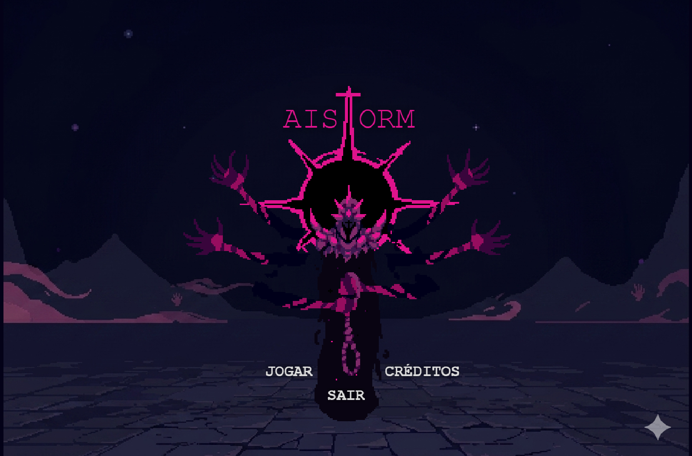
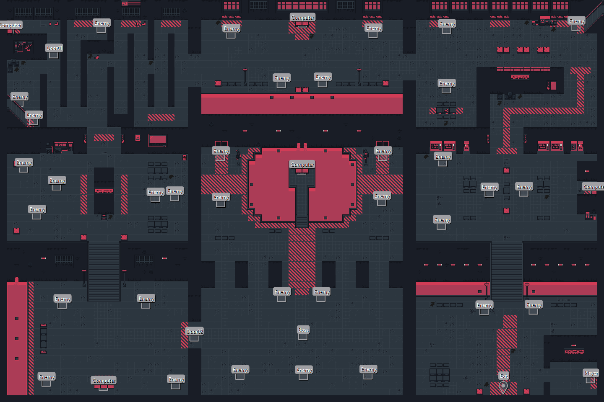

  
  # 🎮 Aistorm
  
  

 

 Aistorm é um jogo de <strong>survival horror</strong> e <strong>stealth</strong> top-down 2D em pixel-art, desenvolvido utilizando o framework <strong>Phaser</strong>. 
  

A história se passa em 2147, época em que Aistorm, uma inteligência artificial criada por humanos, controla de forma autoritária toda a estrutura digital do mundo. Para retomar o controle, uma agente chamada Yoko é enviada para restaurar os nós de memória do sistema.
  

<ul>
  <li>Phaser 3</li>
  <li>Tiled 1.12.2</li>
  <li>Aseprite</li>
  <li>Itch.io</li>
  <li>Pixabay</li>
</ul>

 
